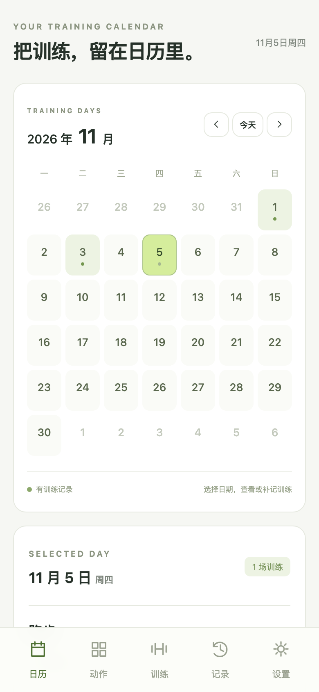
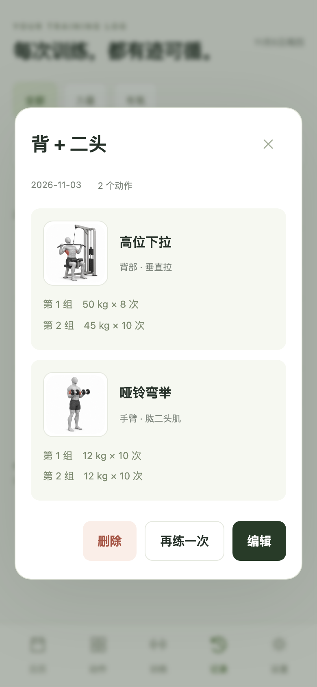
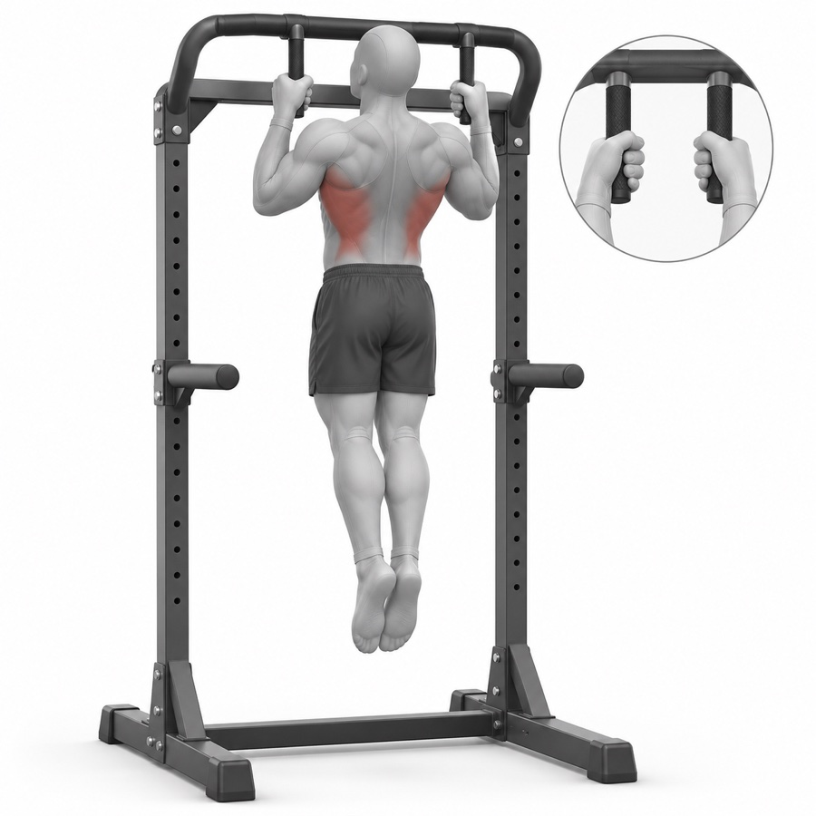
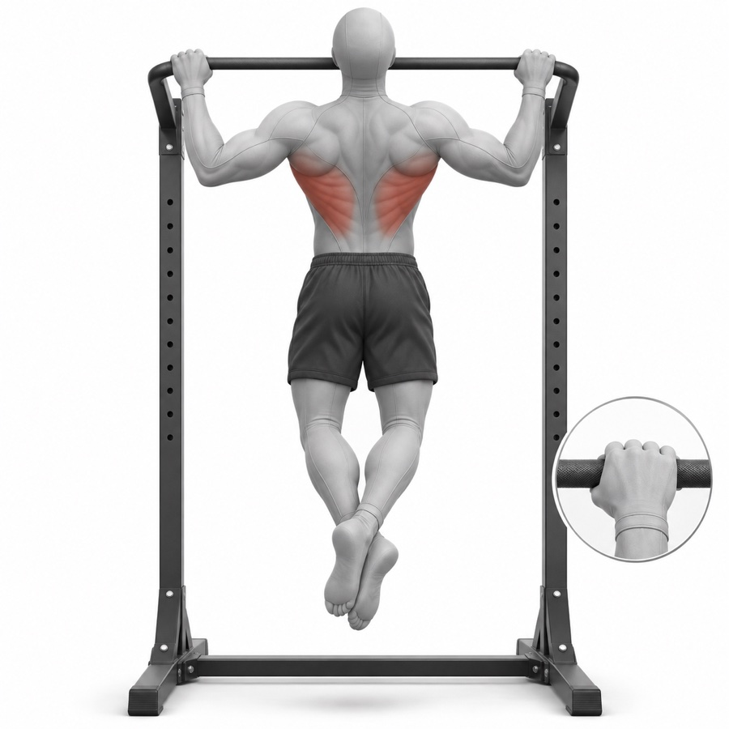
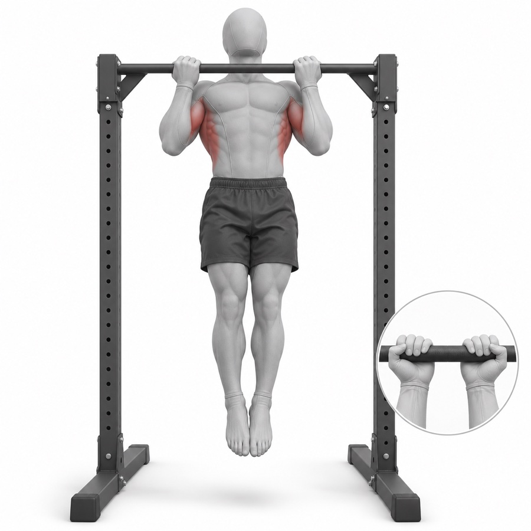

# 练迹 · 健身训练记录 PWA

**把每次训练留在日历里，看到自己的力量变化。**

练迹是一款手机优先的力量与有氧训练记录工具：选择部位和动作，填写每一组的重量、次数或保持秒数，再按日期回看。配备 **337 张统一风格的写实动作示意图**，支持安装到主屏幕、离线记录和 JSON 备份。

[在线使用](https://dagongzhanshi1.github.io/lianji-fitness-pwa/) · [旧版更新入口](https://dagongzhanshi1.github.io/lianji-fitness-pwa/update.html) · [配图说明与提示词](assets/illustrations/README.md) · [参与贡献](CONTRIBUTING.md) · [MIT 许可证](LICENSE)

当前版本 **3.2.0**。334 个预置动作、9 个大类、30 个细分类，以及 3 个补充动作配图。纯 HTML / CSS / JavaScript，无需账户，无服务器端训练数据库，没有第三方运行依赖。

## 应用预览

以下截图均使用虚构的演示训练数据。

<table>
<tr><th>日历与每日记录</th><th>紧凑动作选择</th><th>历史记录与配图</th></tr>
<tr>
<td></td>
<td></td>
<td></td>
</tr>
</table>

## 重点：每个已收录动作都有自己的配图

### 337 张图片，使用同一套视觉风格

配图由 **AI 图像生成工具**制作，统一为灰色无面部训练模型、深灰短裤、白色背景，使用暗红色标出主要发力肌群。334 个预置动作全部配图，另有「宽握对握高位下拉」「下胸飞鸟」「杠铃提拉」3 个补充动作的图片。

这套图片覆盖胸、背、肩、手臂、腿、臀、腹部与核心、全身与功能性和有氧。器械、自由重量、单侧与双侧，以及已收录的不同握法与握距变式分别匹配图片。部分图片带有手部特写，帮助辨认握法。

<table>
<tr><th>中立握引体向上</th><th>宽握引体向上</th><th>反手引体向上</th></tr>
<tr>
<td></td>
<td></td>
<td></td>
</tr>
<tr><td>掌心相对、平行握把</td><td>较宽握距、正握</td><td>反握、掌心朝向自己</td></tr>
</table>

### 选动作、记训练、看历史都能看图

- **选择时**：小图紧凑列表，把更多空间留给可滚动的动作；点击图片放大，点击动作名称选择，再点一次取消。
- **记录时**：动作旁显示图片和该动作的历史最大重量。新动作从一组空白数据开始，不带入上次的组数与重量。
- **回看时**：历史训练详情为每个动作配缩略图，放大后可以返回原记录。
- **离线时**：首次查看后缓存该图；设置中可下载约 **37.1 MiB** 的整套图片。失败后保留已有进度，再次点击可继续。

图片直接存放在本仓库的 [`docs/exercise-media/`](docs/exercise-media/)，运行时不依赖外部动作图库或图像生成服务。文件名包含内容哈希，便于更换图片时避开旧缓存。新建但尚未配图的自定义动作会明确显示“暂无准确示范”，不套用其他动作的图片。

配图制作时逐张检查姿势、握法、器械结构和风格。它们是**静态关键姿势示意图**，并非完整动作动画或实拍照片；发现问题可以按动作名称提交 Issue。

想复用或继续完善这套图，可查看[完整配图说明](assets/illustrations/README.md)、[图片清单与 SHA-256](assets/illustrations/catalog.json)和 [337 项生成提示词](assets/illustrations/prompts.jsonl)。

## 主要功能

| 功能 | 具体用法 |
| --- | --- |
| 日历记录 | 按日期查看训练，一天支持多场，也可以补记过去的训练。 |
| 力量训练 | 每个动作手动添加组数，记录重量与次数；静态动作记录保持秒数。重量单位为 kg，自重可填 0。 |
| 历史最大重量 | 选择动作后显示同名动作已记录的最大重量、日期与次数。只统计填有正数次数／秒数的历史组，不把本次草稿或只有重量的空白组算成纪录。 |
| 有氧训练 | 记录跑步、骑行、游泳等运动的时长和距离，自动计算平均配速与平均速度。 |
| 部位组合命名 | 开始前点选“背 + 二头”“胸 + 三头”等组合，训练中仍可增减；添加其他部位的动作也会加入名称。 |
| 常用动作靠前 | 在每个部位中按已保存训练的使用次数排序。一场训练内同名动作计一次，次数相同则保留目录顺序。 |
| 填写即存本机 | 不需要勾选“是否完成”。输入即保存草稿；手动保存时保留所有动作及未填完的组。 |
| 午夜自动归档 | 跨日后按原训练日期保存，包括未填完整的数据，第二天可继续编辑。 |
| 取消训练／编辑 | 取消正在记录的训练；取消历史编辑时保留原记录。 |
| 历史搜索与编辑 | 按日期、训练名或动作搜索，按力量／有氧筛选；支持修改、再练一次和删除。 |
| 模板与自定义动作 | 保存常用动作顺序；创建自己的动作，区分力量、静态保持或有氧。每次新训练仍从空白组开始。 |
| 备份与导入 | 导出 JSON，导入时按训练 ID 去重，已有同 ID 记录优先保留。 |
| 手机体验 | 重要按钮和输入框加大，设置页面缩放限制，适配主屏幕安装与底部导航。 |

这里的“历史最大重量”是你实际记录过的单组最大负重，**不是估算 1RM**。辅助器械显示的是辅助重量。哑铃按单只还是双侧总重量填写，请在同一动作中保持一致，可用备注注明。

## 安装、离线与更新

1. 用手机浏览器打开[在线地址](https://dagongzhanshi1.github.io/lianji-fitness-pwa/)。iPhone 推荐在原来使用的 Safari 中打开，以继续读取该浏览器的记录。
2. iPhone：分享 → 添加到主屏幕；Android：浏览器菜单 → 安装应用／添加到主屏幕。
3. 首次联网加载后，在设置中确认“离线资源已就绪”；需要断网看全部配图时，再下载整套动作图。
4. 更新时使用设置中的“检查并更新”，或打开[专用更新入口](https://dagongzhanshi1.github.io/lianji-fitness-pwa/update.html)。准备完成后自动返回 App，不清除训练记录或草稿。

App 页面开着时会在本机时间午夜归档。系统挂起或关闭 PWA 后，网页无法保证后台准点执行，**下次打开或回到应用时会按原训练日期补存**；此前输入的内容已经实时写入本机。重复检查不会新增同一训练的副本。

核心程序与配图分开缓存。核心文件全部准备好才启用新版本，图标下载失败不阻止核心离线使用。网络状态变化不重建正在填写的表单；新版就绪时显示更新提示，由你决定何时刷新。

## 数据放在哪里

训练记录保存在**当前设备、当前网站来源、当前浏览器**的 `localStorage`，存储键为 `lianji-fitness-v1`。应用没有训练数据上传接口，也不自动跨设备同步。

- 定期在设置中导出 JSON。清理网站数据、换设备、换浏览器或改部署域名前，先备份再导入。
- Fork 后部署到自己的域名，会成为另一个网站来源，需要自行导入备份。
- GitHub 仓库和发布包只包含程序、动作图、文档与虚构测试数据，不包含个人训练备份。
- 心率、训练总时长等可继续交给 Apple Watch；本应用不读取 Watch 数据，也不提供组间休息计时器。

## 本地运行

需要 Node.js。静态页面无需构建，不需要安装生产依赖。

```bash
 git clone https://github.com/dagongzhanshi1/lianji-fitness-pwa.git
 cd lianji-fitness-pwa
 npm start
```

打开终端输出的 `http://localhost:4173/`。需要换端口时可运行 `PORT=4180 npm start`。

### 部署到自己的 GitHub Pages

Fork 或复制本仓库，在仓库的 **Settings → Pages** 选择 **Deploy from a branch → main → /docs**，等待构建完成。保留 `docs/.nojekyll`，并使用 HTTPS。也可以把整个 `docs/` 部署到其他支持静态页面的 HTTPS 服务。

### 项目结构

```text
 docs/
   app.js                   界面、记录操作、备份与图片下载
   catalog.js               334 个预置动作、部位和细分类
   training-data.js         历史最大重量、排序、序列化与午夜归档
   exercise-art.js          配图展示与握法说明
   exercise-media.js        337 张图片的名称映射和总字节数
   exercise-media/           最终 JPG 图片
   sw.js                    核心与图片离线缓存
   update.html / version.json 旧版更新入口与版本信息
 assets/
   screenshots/             使用虚构数据的应用截图
   illustrations/           图片清单、生成提示词和复用说明
 scripts/                   保存、午夜、离线与旧版升级检查
```

### 开发检查

```bash
 npm run check
 npm install --no-save playwright
 npx playwright install chromium
 npm test
```

浏览器测试可通过 `PLAYWRIGHT_MODULE_PATH` 和 `BROWSER_EXECUTABLE_PATH` 指定已有运行时。旧版升级测试读取历史提交，需要完整 Git 历史；可用 `GIT_EXECUTABLE_PATH` 指定 Git 路径。这些开发工具不属于 App 的运行依赖。

检查覆盖完整和未填完的训练保存、选取／取消动作、空白组、历史配图、午夜归档与次日编辑、备份导入导出、存储失败回滚、服务器断连、图片缓存续传、旧版本更新及移动端布局。

## 开源与贡献

本项目使用 [MIT 许可证](LICENSE)，仓库中的代码、提示词和项目自制配图一起提供。复用时请保留许可证与版权声明。外部姿势参考来源的原始照片或 GIF 不在仓库中，不属于本项目提供的素材。

欢迎提交功能改进或配图纠错。涉及配图时，请提供**动作名称、具体错误和期望的姿势／握法／器械结构**；提交规则见 [CONTRIBUTING.md](CONTRIBUTING.md)。
